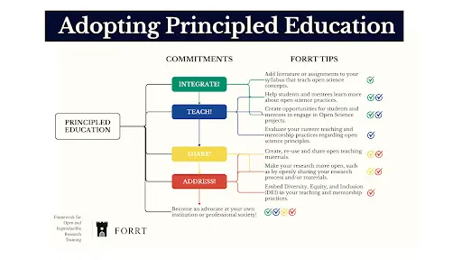
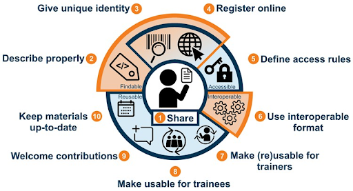

+++
# Adopting Principled Education page

widget = "blank"
headless = true  # This file represents a page section.
active = true  # Activate this widget? true/false
weight = 2  # Order that this section will appear.

title = "Adopting Principled Education"
subtitle = "Implementing fairer teaching and mentoring practices"
classtitle = "text-center"

[design]
  # Choose how many columns the section has. Valid values: 1 or 2.
  columns = "1"

[design.background]
  color = "#fefdf6"
  text_color_light = false

[design.spacing]
  # Customize the section spacing. Order is top, right, bottom, left.
  padding = ["10px", "0", "10px", "0"]

[advanced]
 # Custom CSS.
 css_style = ""

 # CSS class.
 css_class = ""
+++

## What is Principled Education?

**Principled education in open science** is a framework we propose for teaching science and research as a transparent, inclusive, and evolving process. It emphasizes open sharing of materials, critical thinking, and addressing inequities to make science more accessible and just.

<a class="nx-btn-primary" href="#forrt-tips">Explore the 8 FORRT tips</a>
<a class="nx-btn-secondary" href="#adopting-feedback-form-section">Share your feedback</a>

About this guide

In this page, we describe easy ways to adopt principled teaching and mentoring practices. That is, (a) integrating open and reproducible science tenets into your teaching workflow; (b) striving to teach science (or scholarship) as a process of knowledge acquisition rather than a collection of scientific evidence, as doing so does not yield scientific literacy; (c) share publicly your teaching and mentoring (and Lab) materials so that other educators can make use of your excellent work, which also foster social justice through the democratization of scientific educational resources and pedagogies; (d) recognize that Higher Education is a profoundly unequal, non-inclusive and non-diverse environment due to a plethora of societal constraints, which also shapes academia itself, and which we as educators should try to address in class (whatever the subject taught) by integrating course content with topics of representation, diversity, equity, and inclusion. See below for 8 FORRT tips.

<figure class="nx-figure nx-figure--white nx-figure--512">

<figcaption>Figure 1. An illustration of the core commitments of Principled Education and FORRT tips on how to adopt Principled Education. <a href="/img/ape.webp">Open full-size diagram</a></figcaption>
</figure>

### Core commitments of Principled Education

<ul class="nx-commitments" role="list">
<li>AIntegrating open and reproducible science tenets into one’s teaching workflow.</li>
<li>BTeaching science as a process of cumulative discovery, not just a static set of facts, to foster true scientific understanding.</li>
<li>CSharing teaching, mentoring, and research materials publicly so others can use them, helping to promote social justice by making educational resources more accessible to everyone.</li>
<li>DAcknowledging that higher education is often inequitable and non-inclusive, and as educators, we should address this by integrating topics of diversity, equity, and inclusion into our courses.</li>
</ul>

<aside class="nx-note" aria-label="Note on linked resources">

Please note, the following materials are offered only as examples of freely accessible educational materials; they are suggestions rather than endorsements, and in many cases there is no affiliation or relationship with the creators. Inclusion here does not imply methodological endorsement, organizational affiliation, or vetting for pedagogical quality. Please evaluate the fit, accessibility, and licensing of each resource according to your needs.

</aside>

<nav class="nx-tips-nav" id="forrt-tips" aria-label="Jump to the 8 FORRT tips">

### FORRT tips — how you can adopt Principled Education

1. [Evaluate your current teaching and mentorship practices regarding open science principles.](#tip-1)
2. [Add literature or assignments to your syllabus that teach open science concepts.](#tip-2)
3. [Create, re-use and share open teaching materials.](#tip-3)
4. [Help students and mentees learn more about open science practices.](#tip-4)
5. [Create opportunities for students and mentees to engage in open science projects.](#tip-5)
6. [Make your research more open, such as by openly sharing your research process and/or materials.](#tip-6)
7. [Embed Diversity, Equity, and Inclusion (DEI) in your teaching and mentorship practices.](#tip-7)
8. [Become an advocate for principled education at your own institution/professional society.](#tip-8)

<a href="#adopting-feedback-form-section">Share your feedback</a>

</nav>

<section class="nx-tip" id="tip-1">

<h2 id="1-evaluate-your-current-teaching-and-mentorship-practices">1Evaluate your current teaching and mentorship practices</h2>

A great first step is to reflect on your own current teaching and mentoring practices, and the extent to which they communicate the basic tenets of open and reproducible science.

How to evaluate your practices

* FORRT has developed the [FORRT’s Clusters Page](https://docs.google.com/document/d/1_TRh7z3Bv_tdxGqjdWMm4kfQerTYvYw3e4wvQLNpTDQ/edit?tab=t.0#heading=h.9uywlkccaw1) that provides a framework that can be used to help educators make sense of the different key themes of open and reproducible science for independent evaluation of one’s own practices.

</section>

<section class="nx-tip" id="tip-2">

<h2 id="2-add-literature-or-assignments-to-your-syllabus-that-teach-open-science-concepts">2Add literature or assignments to your syllabus that teach open science concepts</h2>

Including sources in your syllabus that discuss open and transparent research can enrich students’ education by helping them think about research more critically. This can be a great addition to research methods courses or any other course that requires students to evaluate or synthesize knowledge.

How to add open science to your syllabus

* Find suitable reading materials for your course syllabus:
  * [FORRT’s Lesson Plans](/lesson-plans/) provide community-built open educational resources that can be integrated into taught courses ‘out of the box’.
  * [FORRT’s curated summaries](/summaries/) of [100+ articles from the open and reproducible scholarship literature](/summaries/).
  * FORRT’s [Open & Reproducible Science Syllabus](/syllabus/) provides examples that you can adapt to your course syllabus.
  * [FORRT’s Clusters](/clusters/) provide curated lists of open-scholarship literature which organize key themes into clusters and sub-clusters with recommended readings.
  * [ReproducibiliTea’s Reading List](https://rpt-rl.netlify.app/) including additional explanatory videos.
  * [The UK Reproducibility Network (UKRN) Primers](https://www.ukrn.org/primers/) series designed to introduce important topics in open and reproducible scholarship to a broad audience which can be re-used into your course syllabus.
* Add activities and/or assignments where students can do things such as:
  * Write their own pre-registration or compare a pre-registration with the published manuscript.
    * [Pre Registration Templates: A curated OSF collection linking to major preregistration templates, each with brief guidance.](https://osf.io/7xrn9)
  * Learn more about the value of [preprints](https://journals.plos.org/plosbiology/article?id=10.1371/journal.pbio.3000151).
  * Learn about the importance of statistical power and use [online tutorials](https://journalofcognition.org/articles/10.5334/joc.72) to work this out for studies.
  * Learn about the process of science and how these are used to produce knowledge by taking the free online [Science Literacy course](https://www.coursera.org/learn/science-literacy) (by Dr. Claire Scavuzzo & Dr. Rachel Buertl at Alberta University).
  * Share outcomes from journal club/reproducibiliTea discussions via blogs, PubPeer, or other avenues. [PubPeer](https://www.pubpeer.com) is a post publication peer review platform where researchers can anonymously share thoughts on research articles. If in a journal club you notice certain shortcomings or inconsistencies, this may be the place to publish them.
  * Run a published article or preprint through [MetaCheck](https://www.scienceverse.org/metacheck/) to assess basic scientific criteria (e.g., whether retracted studies were cited, whether results are reproducible, whether OSF links are working) with the goal of evaluating the credibility, transparency, and reproducibility of the research
  * Do a reproduction or a replication of a study
  * Learn more about p-hacking for students using [Schönbrodt’s p-hacker](http://shinyapps.org/apps/p-hacker/).
  * Learn more about forking paths ([follow this excellent tutorial](http://www.stat.columbia.edu/~gelman/research/published/multiverse_published.pdf), but also check out [FORRT Summaries](/summaries/open-reproducible/#h.rc4vbzxkf0ax) on this topic).
* Assign students to watch videos of a variety of open and reproducible science topics, and discuss it in class:
  * [Center for Open Science](https://www.youtube.com/@CenterforOpenScience/videos): A collection of lectures and webinars on open science topics.
  * [Metascience presentations](https://www.metascience2019.org/presentations/): A collection of talks, panels, and videos from the Metascience Symposiums, focused on reproducibility, scientific reform, and improving research practices.
  * [Mini course on reproducibility & open research](https://www.youtube.com/playlist?list=PLo1sDp2zqD4Rl9AQblQBMQrVblZfEfHcJ): A collection of short videos covering open research principles and practices.
  * [Professor Writes a Scientific Paper in a Day](https://www.youtube.com/watch?v=1gg_eN_UV7k): A video on how to write an academic paper fast.
  * [RIOT Science Club](https://www.youtube.com/@RIOTScienceClub/videos): A collection of videos teaching Reproducible, Interpretable, Open & Transparent Science.
  * [You Lied to Me: A music video about p-values](https://www.youtube.com/watch?v=E0JzVIjj5wI).
  * [The Hitchhiker’s Guide to Academic Publishing](https://www.youtube.com/watch?v=TgTsgbbdUog&t=6025s&ab_channel=CharlieBurlingham): A video discussing the historical background of the current model of academic publishing and arguing for a free, open, transparent and more efficient alternative.
    * Dr. Glaucomflecken- Video tools by a physician who uses humour to explain the manuscript submission and review process, while highlighting common frustrations and oddities in academic publishing:
      * [Academic Journals Doing Crime](https://www.youtube.com/watch?v=8F9gzQz1Pms)
      * [Nature Needs a Reviewer](https://www.youtube.com/watch?v=lt_b4VKBDhI)
      * [How to Publish a Manuscript](https://www.youtube.com/watch?v=dx71U3u--qU)
  * [Paywall: The Business of Scholarship. The Movie](https://www.youtube.com/watch?v=zAzTR8eq20k) - Documentary about the importance of open access.
* Assign students to listen to Podcasts on open and reproducible science (broadly construed):
  * [The Black Goat: A podcast about doing science](https://www.theblackgoatpodcast.com/)
  * [Everything Hertz: A podcast by scientists, for scientists. Methodology, scientific life, and bad language](https://web.archive.org/web/20260122061515/https://everythinghertz.com/)
  * [The HPS Podcast](https://www.hpsunimelb.org/): A podcast about the History, Philosophy, and Social Studies of Science sharing insights from contemporary research with both academic and general audiences
  * [The juice and the squeeze: A zesty podcast by two academics about where, how, and why we focus our efforts](https://www.juiceandsqueeze.net/)
  * [Open Science Talk: A podcast about open science, open access, open education, open data, open software](https://septentrio.uit.no/index.php/OSTalk/issue/archive)
  * [Open Update](https://creators.spotify.com/pod/profile/open-update): The Open Update is Liberate Science's weekly digest on what's been going on in the open science space
  * [The ORION Open Science Podcast](https://orionopenscience.podbean.com/): A podcast about the good, the bad, and the ugly of the current scientific system, and what open science practices can do to improve the way we do science
  * [Quantitude: A podcast dedicated to all things quantitative](https://quantitudepod.org/)
  * [ReproducibiliTea: A podcast highlighting the great work of early career researchers](https://soundcloud.com/reproducibilitea)
  * [Within & Between: A podcast about the methods and metascience of developmental science](https://podtail.com/en/podcast/within-between/)

</section>

<section class="nx-tip" id="tip-3">

<h2 id="3-create-re-use-and-share-open-educational-materials">3Create, re-use and share open educational materials</h2>

Open educational resources allow community members to make contributions and continuously improve the materials. For example, they can enhance their documentation, add media (transcripts, voice, video), translate materials, improve accessibility, and much more. Educators can then reuse and adapt these materials for their own courses, thus reducing the need to produce high-quality materials on their own and saving time better used for teaching and mentoring.

How to find, reuse and make materials FAIR

* Explore existing instances of principled education:
  * [FORRT Pedagogies](/pedagogies/) aims to collect and catalogue exemplary instances of principled education - i.e., successful instances of teaching or mentoring of open and reproducible principles, and detailed examples of the processes by which ideals in teaching, mentoring, and openness of these materials come to materialize.
* Explore existing open educational resources, and [submit your own resources](https://docs.google.com/forms/d/e/1FAIpQLSfPceN5opEeauCBSvapoB-ADpH0IoT24XOLfQGaVEF0EJGFOA/viewform) so that others can adopt them easily into their teaching.
  * FORRT hosts over [1,400 curated educational resources](/resources/) on Open and Reproducible topics on their database.
  * The [OSKB](https://www.oercommons.org/hubs/OSKB) shares open scholarship resources created and curated by the community.
  * Jaclyn Siegel’s document compiles a curated list of [accessible and affordable resources](https://docs.google.com/document/d/1IFbHIN5OOAO0qz-VfCU9nEx4-x6CfArj1-d8ylA2vsU/edit?tab=t.0#heading=h.q1enyigqn74f) tailored for graduate students.
  * [ARIADNE](https://igor-biodgps.github.io/ARIADNE/) is a resource navigator with many (open-access) resources needed throughout the whole research cycle.
* Adopt existing open-access textbooks into your teaching, as well as submit open-access textbooks:
  * [B.C. Open Collection](https://collection.bccampus.ca/)
  * [LibreTexts](https://libretexts.org/)
  * [MERLOT](https://merlot.org/merlot/)
  * [Milne Open Textbooks](https://milneopentextbooks.org/)
  * [OASIS](https://oasis.geneseo.edu/)
  * [OER Commons](https://oercommons.org/)
  * [Open Course Library](https://opencourselibrary.org/)
  * The [Open Textbook Library](https://open.umn.edu/opentextbooks/)
  * [OpenStax](https://openstax.org/)
  * [Pressbooks Directory](https://pressbooks.directory/)
  * [Teaching Commons](https://teachingcommons.us/)
* Use federated search tools to locate additional open-access textbooks and open educational resources:
  * [The Mason OER Metafinder (MOM)](https://oer.deepwebaccess.com/oer/desktop/en/search.html)
* Make your teaching materials as [FAIR](https://www.nature.com/articles/sdata201618) (Findable, Accessible, Interoperable, Reusable) as possible
  * [Garcia et al. (2020)](https://journals.plos.org/ploscompbiol/article?id=10.1371/journal.pcbi.1007854) recommend 10 simple rules for making materials easier to find, (re)use, and adapt (see Figure 2). Their key recommendations include:
    * Properly describing materials by adding sufficient metadata and explanations that are useful to trainees.
    * Giving materials a unique identifying number or URL and adding them to an audience-specific registry such as [OER Commons](https://oercommons.org/).
    * Defining rules for who can access the materials.
    * Creating materials in interoperable formats that allow (re)use in different software programmes and operating systems.
    * Keeping materials up-to-date and inviting contributions from others.

<figure class="nx-figure nx-figure--white nx-figure--512" style="margin-top: 18px;">

<figcaption>Figure 2: An illustration from the paper “Ten simple rules for making training materials FAIR” by <a href="https://journals.plos.org/ploscompbiol/article?id=10.1371/journal.pcbi.1007854">Garcia et al. (2020)</a>. Credit: Luc Wiegers and Celia van Gelder (<a href="https://zenodo.org/record/3593258#.X3J4W2hKgUE">2019</a>) under Creative Commons <a href="https://creativecommons.org/licenses/by/4.0/">CC-BY-4.0</a> license. No modifications have been made to the original.</figcaption>
</figure>
</section>

<section class="nx-tip" id="tip-4">

<h2 id="4-help-students-and-mentees-learn-more-about-open-science-practices">4Help students and mentees learn more about open science practices</h2>

Educators and mentors can actively support students in exploring open and reproducible science through curated resources, experiential learning, and community engagement. This means not only sharing accessible introductory materials, but also encouraging participation in clubs, workshops, or mentorship initiatives.

How to support student and mentee learning

* Use one of the following pedagogical resources:
  * [‘The 4-Step Robustness Check’](https://www.metascience2019.org/presentations/michele-nuijten/) breaks down concepts of reproducibility and replicability exceedingly well:
    * Checking the **internal consistency** of the statistical results.
    * **Reanalyzing the data** using the original analytical strategy.
    * Checking if the result is **robust to alternative analytical choices.**
    * Performing a **replication** study in a new sample.
  * [Seven Easy Steps to Open Science](https://psyarxiv.com/cfzyx) provides an introduction to open science using an annotated reading list of 7 key topics (e.g., pre-registration, open data, reproducible research).
  * [Easing Into Open Science: A Tutorial for Graduate Students](https://psyarxiv.com/vzjdp/) provides simple steps for graduate students to adopt open science practices, along with resources and advice.
* Consider taking part in one of FORRT’s [Towards Social Justice in Academia Initiatives](/dei/) by:
  * Attending, participating, or hosting an [“Open (and Reproducible) Office hours”](/dei/) where anyone in the world wishing to learn, adopt, teach/mentor and disseminate open and reproducible science practices can attend.
  * Additional ways to involve students in **Towards Social Justice In Academia Initiatives** can be found in [tip 8](#tip-8).
* Encourage students to join a local [ReproducibiliTea](https://reproducibilitea.org/) chapter.
  * **ReproducibiliTea** is a global journal club initiative that encourages students and staff to read and discuss journal articles related to open science. If one doesn’t exist in your university/city, you can start your own local chapter!
* Encourage your mentees to join courses or workshops related to open science research ([see here for a variety of Open and Reproducible science resources](/resources/) but bear in mind the list of teaching-specific resources is in progress).
  * [OpenLearn Create](https://www.open.edu/openlearncreate/course/index.php?categoryid=1589) offers a variety of free online courses on research methods, open science practices, and reproducible research.
* And encourage students to check out these introductions to open science topics:
  * [UKRN: Open research primers](https://www.ukrn.org/primers/): Important topics in open and reproducible scholarship.
  * [INOSC Starter Kit](https://inosc-starter-kit.netlify.app/): Open Science Community Starter Kit.
  * [FORRT: Course on Open Science 101](/educators-corner/017-teaching-os-to-undergraduates/): Introducing open science and research integrity to undergraduates.
  * [A Student’s Guide to Open Science: Using the Replication Crisis to Reform Psychology](/educators-corner/014-students-guide-to-open-science/).
  * FORRT: [The PaPOR TRaIL Course: Principles and Practices in Open Research: Teaching, Research, Impact and Learning.](/educators-corner/009-papor-trail/)

</section>

<section class="nx-tip" id="tip-5">

<h2 id="5-create-opportunities-for-students-and-mentees-to-engage-in-open-science-research-projects">5Create opportunities for students and mentees to engage in open science research projects</h2>

Involving students in open science projects is an effective way to deepen their understanding of transparent and collaborative research practices. These experiences can also help them connect with like-minded researchers, gain mentorship, and build valuable skills—especially early in their academic journey.

How to involve students in open science projects

* Join Established Collaborative Projects
  * The [Collaborative Replications and Education Project in Psychology](https://osf.io/wfc6u/wiki) supports student-led replication studies in psychology, often for dissertations, in collaboration with other universities.
  * The Psychology Science Accelerator ([PSA](https://psysciacc.org/)) runs large-scale, multi-lab experiments that follow open science principles. Students can participate through dissertations, internships, or course projects.
* Design Your Own Replication Project
  * Encourage students to replicate a classic study as part of a class assignment. This helps them understand the importance of reproducibility and scientific integrity.
  * Helpful resources for classroom replication projects include:
    * [ReplicationWiki – Economics and social sciences](https://blog.repec.org/2020/08/04/a-replication-database-for-economics-and-social-sciences-the-replicationwiki/): A collaborative database documenting replication attempts, methods, and outcomes in economics and social science.
    * [Political Science Replication](https://politicalsciencereplication.wordpress.com/about/): A directory of replication studies focused on political science, promoting methodological transparency.
    * [Project Tier’s Learning Course Materials](https://www.projecttier.org/tier-classroom/course-materials/): Course materials on topics such as open science, data analysis and replication in empirical research.
    * [FORRT workshop: Teaching the why and how of replication studies](/educators-corner/004-teaching-why-how-replication/).
    * [Brian Dillon’s Linguistics class](https://people.umass.edu/bwdillon/project/linguist-609-2020/): A graduate-level course focusing on statistical methods for analyzing linguistic and experimental data.
    * [Replication Reports Templates](https://osf.io/8dkxc/): A collection of academic paper templates which integrate open science and replication concepts in disciplines such as Economics, Politics and Psychology.
    * The [FORRT Replication Hub](/replication-hub/): A comprehensive collection of resources and tools designed to assist researchers in the identification, evaluation, execution, and publication of replication studies.
    * Resources from the [CORE Team](https://mgto.org/core-team/) led by Dr. Gilad Feldman
  * Helpful resources for reproduction/computational reproducibility include:
    * [Reproducible paper guidelines, AGILE Conference](https://osf.io/numa5): Guidelines on increasing computational reproducibility of scholarly manuscripts.
    * [Econometric Society: A checklist for replication packages](https://www.econometricsociety.org/uploads/reports%20Editorial/ES_Data_Editor_Website/Checklist.pdf).
    * [ACRE](https://bitss.github.io/ACRE/): Guide for Accelerating Computational Reproducibility in the Social Sciences (ACRE).
    * [Reproducibility Report Checklist Example](https://osf.io/tndzk): A checklist for reproducibility practices, designed to help educators and researchers systematically integrate replication principles into teaching and research workflows.
  * Helpful resources for overall robustness/validity include:
    * [A Protocol for Structured Robustness Reproductions and Replicability Assessments](https://econpapers.repec.org/paper/zbwi4rdps/143.htm): A list of three different reporting tools used to streamline the presentation of results and assess adherence to pre-analysis plans in the replicated papers, as well as to evaluate external and construct validity.
    * [Author Guidelines for Verification Reports](https://openpsychologydata.metajnl.com/verification-reports): Guidelines for evaluating claims in published research by reanalysing original study data.
    * [FORRT’s 60+ pages guide on reproductions and replications](https://forrt.org/replication-handbook/).
* Review and evaluate examples of replication studies and reproducibility reviews found from directories below:
  * [ReplicationWiki – Economics and social sciences](https://blog.repec.org/2020/08/04/a-replication-database-for-economics-and-social-sciences-the-replicationwiki/)
  * [Political Science Replication](https://politicalsciencereplication.wordpress.com/about/)
  * [Reproducibility Reviews AGILE 2024](https://osf.io/qvr4s/) ([guidelines](https://osf.io/numa5)).

</section>

<section class="nx-tip" id="tip-6">

<h2 id="6-make-your-research-open">6Make your research open</h2>

Sharing your research openly helps others learn from your work. Educators can use open data and materials in their teaching—for example, in hands-on classroom activities like data analysis or mini-replication projects. This makes your work more impactful and supports student learning at both undergraduate and graduate levels.

How to share your research openly

* [Open Science Framework](https://osf.io/): A popular platform where research data and materials can be easily shared and indexed.
* [Zenodo](http://zenodo.org/): Another trusted platform for uploading and sharing research outputs. Supports a range of file types and provides DOIs.
* [re3data](https://www.re3data.org/): A searchable directory of research repositories across different fields. Great for finding a subject-specific platform for your work.
* [Table with Open Access Types](https://lukasroeseler.github.io/MueCOS-Infomodule/%C3%BCbergreifend/gen_3.html#zentrale-typen-von-open-access) (original is in German): An overview of the most common Open Access models, evaluating their accessibility and cost implications.
* [GitHub](https://github.com/): Online platform for creating, storing, managing, and sharing code, with version control.

</section>

<section class="nx-tip" id="tip-7">

<h2 id="7-embed-diversity-equity-and-inclusion-dei-in-your-teaching-and-mentorship">7Embed Diversity, Equity, and Inclusion (DEI) in your teaching and mentorship</h2>

Higher education is still a profoundly inequitable, non-inclusive, and non-diverse environment shaped by deep-rooted societal constraints. Educators have the responsibility and opportunity to address these issues—regardless of the subject they teach—by integrating diversity, equity, and inclusion (DEI) principles into their teaching and mentoring practices.

**Common structural barriers and how to address them:**

<ul class="nx-tip-barriers" role="list">
<li><strong>Paywalled readings</strong> → substitute open access (OA) versions / library link / author PDFs / summaries.</li>
<li><strong>Participation grading</strong> → alternative modes (written / audio / anonymous).</li>
<li><strong>Group work inequities</strong> → structured roles, rotating facilitation, credit tracking.</li>
<li><strong>Neurodiversity</strong> → predictable structure, multiple submission formats, low-sensory options.</li>
</ul>

How to embed DEI in teaching and mentorship

* Foster an inclusive classroom culture:
  * Check out [Stanford’s Inclusive Teaching Guide](https://teachingcommons.stanford.edu/teaching-guides/inclusive-teaching-guide) for tips on creating equitable learning environments, supporting diverse student needs, and embedding inclusion into everyday teaching practices.
  * Explore [Fostering Inclusive Learning: A Guide for Faculty in Higher Education by Goldman & Eiduson](https://hsrc.himmelfarb.gwu.edu/educational_resources_teaching/2/) for practical, research-informed strategies on building inclusive syllabi, content, classroom climate, and assessments.
  * Ensure materials are open and accessible (e.g., transcripts, readable formats, multilingual resources, alt text, audio versions) helping remove barriers related to disability, language, and socio-economic status.
* Use [FORRT’s Academic Wheel of Privilege](/awop/) as a class exercise to integrate DEI topics in the course curricula and make relevant connections to the structures of academia:
  * Ask students to locate themselves on the Academic Wheel of Privilege by reflecting on where they fall across various identity dimensions. Discuss together how these intersecting aspects of their identity influence their academic experiences and may shape their future career trajectories. To deepen this reflection, assign students to write a positionality statement that thoughtfully explores how their identity, background, and experiences inform their perspective and place within the academic landscape. Example of a positionality statement: [https://osf.io/2rcuz_v1](https://osf.io/2rcuz_v1)
  * Present scenarios in which two researchers from different backgrounds collaborate, and assign students to small groups to discuss how factors such as privilege and marginalization might influence recognition and credit. Encourage them to consider how systemic advantages can shape decisions around authorship order, funding opportunities, and collaborative dynamics. Follow with a plenary discussion to surface these insights and make visible the often-invisible ways privilege operates in academic settings.
* Diversify your syllabus.
  * Use one of [FORRT’s lesson plans](/neurodiversity-lessonbank/) that aim to promote Neurodiversity and Open Scholarship in Academia.
  * Use resources such as the [BIPOC-authored Psychology Papers spreadsheet](https://docs.google.com/spreadsheets/d/1i7Eacoyv9VVg2lBbCV-KJZg4nSGvR_VZFOysOyOGG8g/edit?fbclid=IwAR1zlaZHcY1HMYYnaa5M96aC577qDagmphf_R7EH2YXBl_P1ihJcPu9zUPM&gid=666010790#gid=666010790%20), intended for use by instructors of undergraduate/ graduate-level psychology courses to help diversify their syllabi, or [the Diversity Reading list](https://diversityreadinglist.org/about/) offering quality texts in philosophy by authors from underrepresented groups, or [FORRT’s annotated reading list](/curated_resources/point-of-view-an-annotated-introductory/) supporting readers in understanding some of the key ideas and topics within neurodiversity.
* Use inclusive citation practices.
  * Consider adding a [Citation Diversity Statement](https://doi.org/10.1016/j.tics.2020.06.009) in your course materials or assignments, to acknowledge and intentionally include scholarship from diverse voices and underrepresented groups.
  * Use [McGill’s Citation Justice Guide](https://libraryguides.mcgill.ca/citation_justice/how_to) to help students audit their citation practices and intentionally seek out diverse voices in their research. The guide offers practical tools for analyzing whose work is being cited, identifying gaps, and finding resources to include scholars from marginalized communities.
  * Read [FORRT’s Manuscript](/citation-politics/) on The Citational Justice Toolkit which offers practical guidance and tools to help researchers make more equitable and conscientious citation choices throughout the research process.
* Engage with **Towards Social Justice In Academia Initiatives:**
  * [FORRT’s remote mentorship program](/dei/) aims to facilitate and encourage adherence to open and reproducible research practices for (a) students from underprivileged and underrepresented backgrounds; (b) non-WEIRD; and (c) when there are no local open science friendly institutions or personnel.
  * [FORRT’s supporting underprivileged and underrepresented early-career researchers initiative](/dei/) serves as a link between willing mentors and mentees in their engagement with academia, its several duties (e.g., application materials, grant/funding proposals, academic writing, research development, statistical analyses, etc.), as well as open and reproducible science practices. It is FORRT’s goal to chip away at the barriers that exist and to promote a more inclusive environment for all ([Roberson, 2020](https://doi.org/10.1038/s41562-020-0926-6)).

</section>

<section class="nx-tip" id="tip-8">

<h2 id="8-become-an-advocate-at-your-own-institutionprofessional-society">8Become an advocate at your own institution/professional society</h2>

A great way to adopt the values of principled education is to advocate in your own institution for incorporating the values of open science and transparent research into teaching.

How to advocate at your institution or society

* Within your institution:
  * If you're part of a teaching committee, suggest adding open science topics to course content, as simple as adding a slide or a real-world example.
  * Start conversations with colleagues about including transparency and reproducibility in the curriculum.
  * If you are involved in hiring decisions, try to understand the quality criteria used. If your institution is only using citation numbers or Journal Impact Factors, make everybody aware of [sfdora.org](http://sfdora.org) and [coara.eu](http://coara.eu) (if you are at a big university, chances are high that they signed SF DORA); maybe you can ask the committee to use [resque.info](http://resque.info). Relying solely on bibliometrics is not useful if the aim is to choose a qualified person as they are not reproducible and possibly unrelated to scientific quality (e.g., [Prestigious Science Journals Struggle to Reach Even Average Reliability](https://www.frontiersin.org/journals/human-neuroscience/articles/10.3389/fnhum.2018.00037/full)).
* Within professional societies or unions:
  * Advocate for policies that support openness, transparency, and equality in research and education.
  * Encourage societies to offer workshops, resources, or statements supporting these values.
* Track open science adoption: Monitoring how open science is implemented across journals reveals progress, gaps, and opportunities for change. It also provides concrete examples to inform discussions in advocacy, teaching, and policy. Use the following tools to track OS uptake and support data-informed advocacy:
  * [OSF Registries](https://osf.io/registries) – Monitor how often studies are preregistered, and explore trends in research transparency across disciplines. To see how many registrations there are by subject you can use the [OSF registries website](https://osf.io/registries).
  * [Registered Reports Database](https://docs.google.com/spreadsheets/d/1D4_k-8C_UENTRtbPzXfhjEyu3BfLxdOsn9j-otrO870/edit?gid=0#gid=0) – Discover which journals accept Registered Reports, a publishing format that promotes methodological rigor by reviewing research plans before data collection.
  * [TOP Factor](https://topfactor.org/) – Compare journals based on their transparency and openness policies. This tool rates journals across 10 dimensions, including data sharing, preregistration, and replication.
  * [Peer Community In (PCI)](https://peercommunityin.org/) – Explore peer-reviewed preprint platforms across disciplines that support open, transparent, and community-driven scholarly communication.
* Connect with others who care about open research by joining networks such as:
  * [ABRIR](https://abrirpsy.org/): An international network of researchers and practitioners dedicated to promoting open, reproducible, and transparent research practices across disciplines.
  * [FORRT](/): A collaborative forum connecting educators and researchers who develop, share, and discuss resources for teaching open and reproducible science.
  * [The repliCATS project](https://replicats.research.unimelb.edu.au/): A collaborative initiative that engages researchers in systematically assessing reproducibility and credibility in published research, fostering methodological reflection and community learning.
  * [Quala Lab](https://qualalab.org/): Collaborative working group finding connections between the open science movement and qualitative and mixed methods research.
  * [Reproducibility Network](https://www.ukrn.org/global-networks/): National peer led consortium of researchers aiming to promote and ensure rigorous research practices.
  * [ReproducibiliTea](https://reproducibilitea.org/): A global journal club initiative that encourages students and staff to read and discuss journal articles related to open science.

</section>

## What do you think of these tips?

Have you used any of these tips? What do you think worked well or what did you have to change? What demographic of students did you use this for (e.g. Bachelor, Masters, PhD)?

We welcome contributions from educators, researchers, and practitioners who would like to help expand and enrich these resources. Have your say through the form.

### Share back

You can also submit a short contribution to FORRT’s curated database or directly to this page. This may include:

* a syllabus snippet
* an assignment
* a case study

Please submit them through our [resource submission form](https://docs.google.com/forms/d/e/1FAIpQLSfPceN5opEeauCBSvapoB-ADpH0IoT24XOLfQGaVEF0EJGFOA/viewform) (or explore all submission routes via [/submit](/submit/)). Please note that contributors can get credit. We are committed to transparent and meaningful attribution. Contributors are credited using our formal crediting mechanism (Tenzing / CRediT taxonomy). List yourself under Provider/Creators in the form so that you can be properly credited for your contribution. We value community knowledge and aim to recognise all contributions appropriately.



