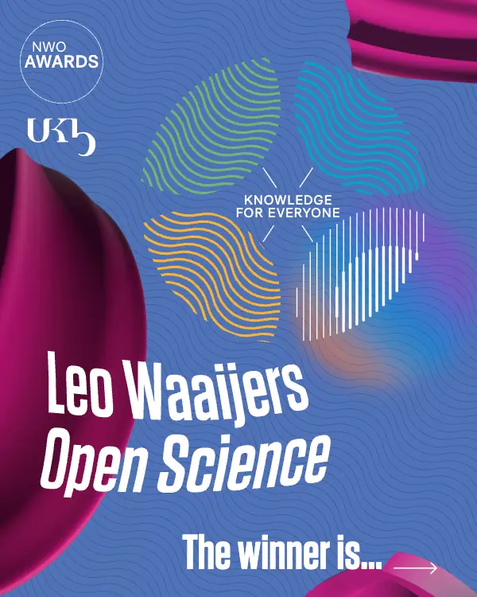
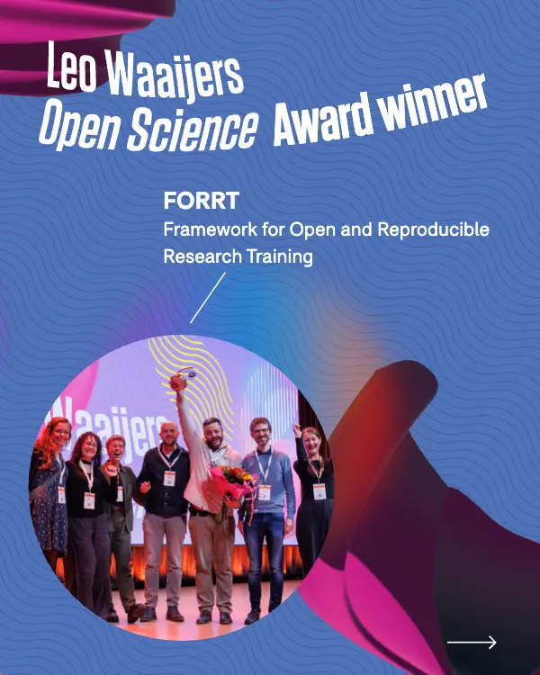
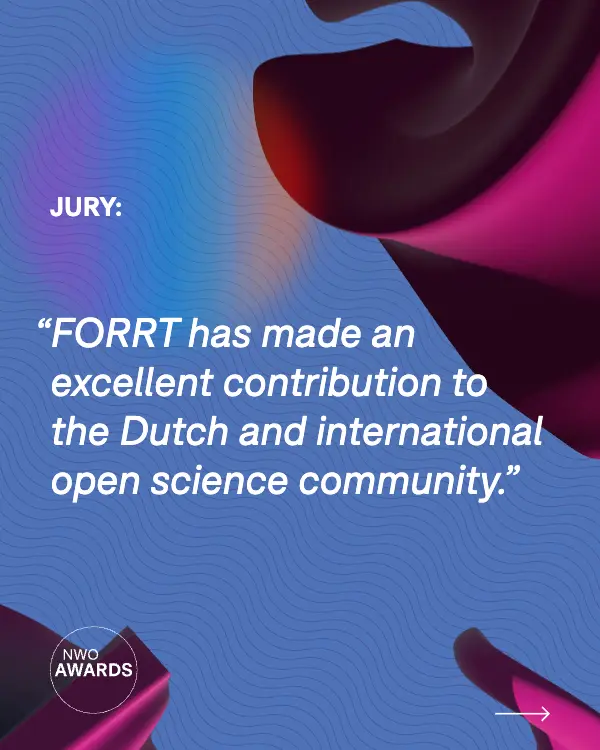
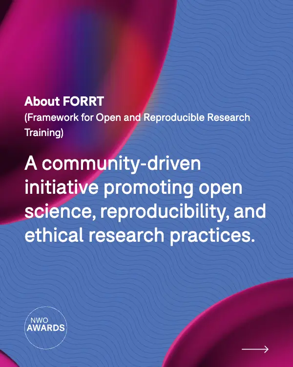
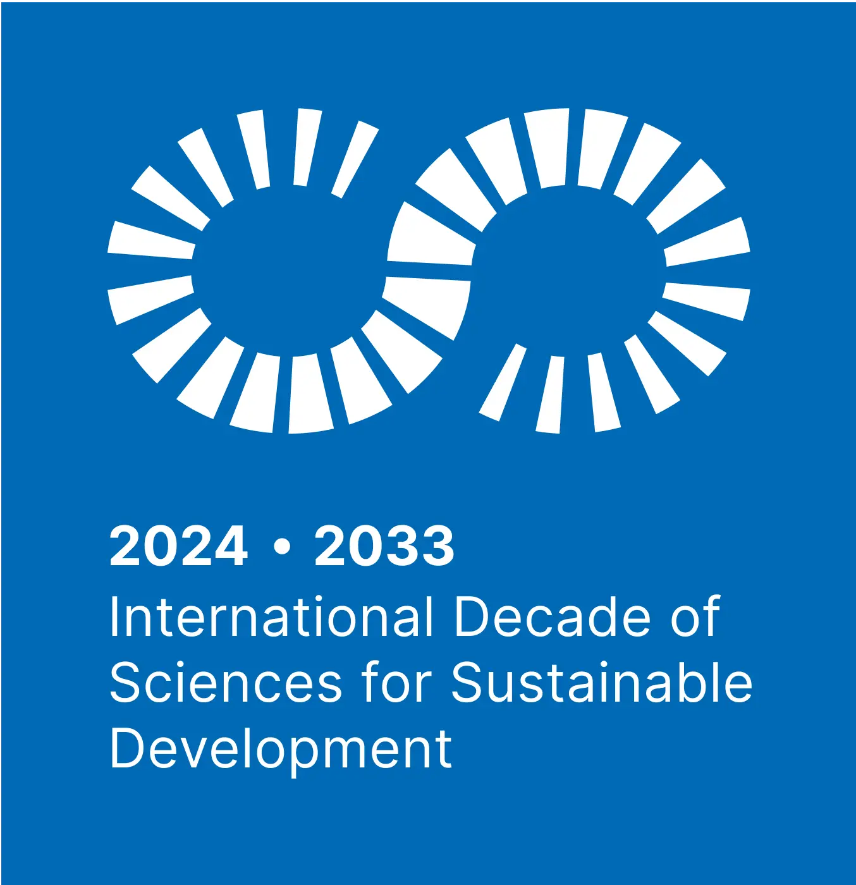
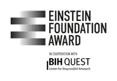

+++
widget = "blank"
headless = true
active = true
weight = 10

title = "Awards & Impact"
subtitle = ""

[design]
  columns = "1"

[design.background]
  text_color_light = false

[design.spacing]
  padding = ["60px", "0", "60px", "0"]

[advanced]
  css_style = ""
  css_class = ""
+++

  
Thanks to our amazing community, FORRT has become an <strong>award-winning</strong> grassroots interdisciplinary international organization integrating open and reproducible research training into higher education.

  <nav class="awards-jump" aria-label="Jump to awards by year">
    <a href="#featured-recognitions">Featured</a>
    <a href="#awards-2025">2025 (5)</a>
    <a href="#awards-2023">2023 (6)</a>
    <a href="#awards-2022">2022 (4)</a>
    <a href="#awards-2021">2021 (3)</a>
    <a href="#awards-2020">2020 (1)</a>
    <a href="#impact-and-achievements">Impact &amp; achievements</a>
  </nav>

<h2 id="featured-recognitions" class="awards-section-heading">Featured recognitions</h2>

  <article class="award-featured">
    
2026 · Open Science NL

    <h3><a href="https://www.openscience.nl/en/news/forrt-awarded-with-the-leo-waaijers-open-science-award-2026" target="_blank" rel="noopener">The Leo Waaijers Open Science Award 2026</a></h3>
    

      
      
      
      
    

    
<strong>The Leo Waaijers Open Science Award</strong> aims to recognise and reward outstanding contributions to open science in the Netherlands by highlighting these achievements. The award seeks to inspire others to apply and promote open science, stimulate innovation and strengthen the open science movement.

    
<a href="https://www.openscience.nl/en/news/forrt-awarded-with-the-leo-waaijers-open-science-award-2026" class="btn dir-btn" target="_blank" rel="noopener">Read more <i class="fas fa-external-link-alt" aria-hidden="true"></i> (another website)</a>

  </article>

  <article class="award-featured award-featured-unesco">
    
2024–2033 · UNESCO &amp; United Nations

    <h3><a href="../educators-corner/023-forward-a-unesco-decade-of-science-programme/">FORWARD: A UNESCO Decade of Science Programme</a></h3>
    

      
      

        
<strong>FORRT</strong> is one of the few initiatives worldwide to be formally endorsed as a <strong>Programme</strong> of the <a href="https://www.un-sciences-decade.org/en/endorsed-activities/forward-forrt-world-development-fostering-open-research-reproducibility-worldwide-accessible?hub=63" target="_blank" rel="noopener">International Decade of Sciences for Sustainable Development (IDSSD, 2024–2033)</a>, led by UNESCO and the United Nations (UN). This endorsement reflects the highest level of UN policy recognition and positions FORRT’s work in Education &amp; Pedagogy (Curriculum Hub), Metascience &amp; Research (Replication Hub) and Social Justice &amp; DEIA as an <strong>essential contribution to the UN’s strategy for achieving the Sustainable Development Goals (SDGs)</strong>.

        
<a href="https://www.un-sciences-decade.org/en/endorsed-activities/forward-forrt-world-development-fostering-open-research-reproducibility-worldwide-accessible?hub=63" class="btn dir-btn" target="_blank" rel="noopener">Read the official UNESCO announcement <i class="fas fa-external-link-alt" aria-hidden="true"></i> (another website)</a>

      

    

    
  </article>

<h2 id="awards-2025" class="awards-year-heading">2025</h2>

  <article class="award-card">
    

      

      
Society for the Improvement of Psychological Science

    

    <h3>Mission Award — Educational resources on the replication crisis</h3>
    
In 2025, FORRT received the <strong><a href="/positive-changes-replication-crisis/">Mission Award for Educational resources on the replication crisis</a></strong> from the Society for the Improvement of Psychological Science.

    
<a href="https://improvingpsych.org/mission/awards/#:~:text=SEMA3-,June%202025,Educational%20resources%20on%20the%20replication%20crisis,-June%202025" target="_blank" rel="noopener">Announcement <i class="fas fa-external-link-alt" aria-hidden="true"></i> (another website)</a>

  </article>

  <article class="award-card">
    

      

      
Society for the Improvement of Psychological Science

    

    <h3>Commendation Award — Pownall et al. (2023)</h3>
    
In 2025, FORRT received a <strong>Commendation Award for <a href="https://doi.org/10.1098/rsos.221255" target="_blank" rel="noopener">Pownall et al. (2023): Teaching open and reproducible scholarship: a critical review of the evidence base for current pedagogical methods and their outcomes</a></strong> from the Society for the Improvement of Psychological Science.

    
<a href="https://improvingpsych.org/mission/awards/" target="_blank" rel="noopener">Announcement <i class="fas fa-external-link-alt" aria-hidden="true"></i> (another website)</a>

  </article>

  <article class="award-card">
    

      

      
Society for the Improvement of Psychological Science

    

    <h3>Commendation Award — Open Science in the Developing World</h3>
    
In 2025, FORRT received a <strong>Commendation Award for <a href="/os-developing-world/">Open Science in the Developing World: A Collection of Practical Guides for Researchers in Developing Countries</a></strong> from the Society for the Improvement of Psychological Science.

    
<a href="https://doi.org/10.1177/25152459251357565" target="_blank" rel="noopener">Published article <i class="fas fa-external-link-alt" aria-hidden="true"></i> (another website)</a> <a href="https://improvingpsych.org/mission/awards/" target="_blank" rel="noopener">Announcement <i class="fas fa-external-link-alt" aria-hidden="true"></i> (another website)</a>

  </article>

  <article class="award-card">
    

      

      
Society for the Improvement of Psychological Science

    

    <h3>Commendation Award — International Initiatives Systematic Mapping Review</h3>
    
In 2025, FORRT received a <strong>Commendation Award for <a href="https://doi.org/10.1098/rsos.241726" target="_blank" rel="noopener">International Initiatives to Enhance Awareness and Uptake of Open Research in Psychology: A Systematic Mapping Review</a></strong> from the Society for the Improvement of Psychological Science.

    
<a href="https://improvingpsych.org/mission/awards/" target="_blank" rel="noopener">Announcement <i class="fas fa-external-link-alt" aria-hidden="true"></i> (another website)</a>

  </article>

  <article class="award-card">
    

      

      
Society for the Improvement of Psychological Science

    

    <h3>Commendation Award — FORRT Credit Project</h3>
    
In 2025, FORRT received a <strong><a href="/contributors/">Commendation Award for FORRT Credit Project</a></strong> from the Society for the Improvement of Psychological Science.

    
<a href="https://improvingpsych.org/mission/awards/" target="_blank" rel="noopener">Announcement <i class="fas fa-external-link-alt" aria-hidden="true"></i> (another website)</a>

  </article>

<h2 id="awards-2023" class="awards-year-heading">2023</h2>

  <article class="award-card">
    

      

      
UK Reproducibility Network

    

    <h3>Dorothy Bishop Prize</h3>
    
In 2023, FORRT was awarded the <strong><a href="https://www.ukrn.org/2023/03/21/db-prize-winners-mar2023/" target="_blank" rel="noopener">Dorothy Bishop Prize</a></strong> from the UK Reproducibility Network, for its work towards integrating open science principles into higher education and advancing research transparency, reproducibility, rigor, and ethics through pedagogical reform.

  </article>

  <article class="award-card">
    

      

      
Einstein Foundation

    

    <h3>Early Career Award finalist</h3>
    
In 2023, FORRT was a <strong>finalist</strong> for the <strong><a href="https://award.einsteinfoundation.de/award-winners-finalists/recipients-2023/early-career-researcher-award-2023-finalists" target="_blank" rel="noopener">Early Career Award</a></strong> for Promoting Quality in Research from the Einstein Foundation for its <a href="/replication-hub/">Replication Hub</a> initiative.

  </article>

  <article class="award-card">
    

      

      
Open Science Community Amsterdam (INOSC)

    

    <h3>OSC Award — Open Educational Resources</h3>
    
In 2023, FORRT received an <strong><a href="https://osc-international.com/osc-amsterdam/looking-back-oscawards/" target="_blank" rel="noopener">OSC Award</a></strong> in the Open Educational Resources / Open Education / Open Online Courses category from Open Science Community Amsterdam, receiving €200. This was for our paper, <a href="https://doi.org/10.1186/s13104-022-05944-1" target="_blank" rel="noopener">The role of pedagogical communities</a>.

    
<a href="https://youtu.be/7wYW7xpqbUY" target="_blank" rel="noopener">Watch our successful pitch on YouTube <i class="fas fa-external-link-alt" aria-hidden="true"></i> (another website)</a>

  </article>

  <article class="award-card">
    

      

      
Society for the Improvement of Psychological Science

    

    <h3>Mission Award</h3>
    
In 2023, FORRT received the <strong>Mission Award</strong> from the Society for the Improvement of Psychological Science for its overall initiatives.

    
<a href="https://improvingpsych.org/mission/awards/" target="_blank" rel="noopener">Announcement by SIPS <i class="fas fa-external-link-alt" aria-hidden="true"></i> (another website)</a>

  </article>

  <article class="award-card">
    

      

      
JISC

    

    <h3>Community Champion</h3>
    
In 2023, FORRT was named a <strong><a href="https://www.jisc.ac.uk/news/all/jisc-announces-2023-community-champions" target="_blank" rel="noopener">Community Champion for UK education and research communities</a></strong> by JISC.

  </article>

  <article class="award-card">
    

      

      
Society for the Improvement of Psychological Science

    

    <h3>Commendation Award — Replications &amp; Reversals</h3>
    
In 2023, FORRT received a <strong>Commendation award</strong> from the Society for the Improvement of Psychological Science for its <a href="/reversals/">Replications &amp; Reversals</a> project.

    
<a href="https://improvingpsych.org/2023/08/22/sips-2023-awards-announced/" target="_blank" rel="noopener">Announcement by SIPS <i class="fas fa-external-link-alt" aria-hidden="true"></i> (another website)</a>

  </article>

<h2 id="awards-2022" class="awards-year-heading">2022</h2>

  <article class="award-card">
    

      

      
Atlantic Technological University &amp; OSC Galway

    

    <h3>Open Scholarship Prize (1st Place)</h3>
    
In 2022, FORRT received an <strong>Open Scholarship Prize (1st Place)</strong> award from the Atlantic Technological University and the Open Science Community Galway for its several initiatives aiming to help researchers integrate Open Science into their educational pipeline, receiving €200/£189.

  </article>

  <article class="award-card">
    

      

      
Society for the Improvement of Psychological Science

    

    <h3>Grants-In-Aid — Neurodiversity initiative</h3>
    
In 2022, FORRT received a <strong>Grants-In-Aid to Reduce Barriers to Improving Psychological Science</strong> from the Society for the Improvement of Psychological Science for the FORRT's Neurodiversity initiative, receiving $1250.

  </article>

  <article class="award-card">
    

      

      
Association for Learning Technology

    

    <h3>Open Scholarship Conference award</h3>
    
In 2022, FORRT received an <strong>Open Scholarship Conference award</strong> from the Association for Learning Technology for its initiatives, receiving €200/£189. This was linked to our presentation at the OER22 Conference.

  </article>

  <article class="award-card">
    

      

      
Society for the Improvement of Psychological Science

    

    <h3>Commendation — Summaries of Open Science</h3>
    
In 2022, FORRT received a <strong><a href="https://improvingpsych.org/mission/awards/" target="_blank" rel="noopener">Commendation</a></strong> from the Society for the Improvement of Psychological Science for its <a href="/summaries/">Summaries of Open Science</a> project.

  </article>

<h2 id="awards-2021" class="awards-year-heading">2021</h2>

  <article class="award-card">
    

      

      
The Hidden REF

    

    <h3>HiddenREF Commendation</h3>
    
In 2021, FORRT has received a <strong>Commendation</strong> from the <a href="https://hidden-ref.org/" target="_blank" rel="noopener">HiddenREF</a> for its initiatives advancing training materials and resources on open and reproducible science.

    
<a href="https://youtu.be/btjRNG0NANg?t=1070" target="_blank" rel="noopener">Watch a recording of the award ceremony on YouTube <i class="fas fa-external-link-alt" aria-hidden="true"></i> (another website)</a>

  </article>

  <article class="award-card">
    

      

      
Open Scholarship Community Galway

    

    <h3>Open Scholarship Award (2nd Place)</h3>
    
In 2021, FORRT has received an <strong>Open Scholarship Award (2nd Place)</strong> from the <a href="https://osc-galway.ie/competition/" target="_blank" rel="noopener">Open Scholarship Community Galway</a> for its overall initiatives.

  </article>

  <article class="award-card">
    

      
Kellogg School of Management

    

    <h3>Consultancy on “Leading &amp; Managing Teams”</h3>
    
In 2021, FORRT has received a <strong>consultancy on “Leading &amp; Managing Teams”</strong> from the Kellogg School of Management.

  </article>

<h2 id="awards-2020" class="awards-year-heading">2020</h2>

  <article class="award-card">
    

      

      
Society for the Improvement of Psychological Science

    

    <h3>Commendation — Introducing FORRT</h3>
    
In 2020, FORRT has received a <strong>Commendation</strong> from the <a href="https://improvingpsych.org/mission/awards/" target="_blank" rel="noopener">Society for the Improvement of Psychological Science</a> for its manuscript <a href="https://osf.io/bnh7p/" target="_blank" rel="noopener">“Introducing a Framework for Open and Reproducible Research Training (FORRT)”</a>.

  </article>

<h2 id="impact-and-achievements" class="awards-section-heading">Impact and achievements</h2>

Our work is sharing open scholarship with a wide audience. Our highlights include...

<ul class="impact-list">
  <li><strong>Four</strong> of our projects are featured in UNESCO's <a href="https://www.unesco.org/en/open-science/list?hub=686" target="_blank" rel="noopener">Open Science Capacity Building Index</a>.</li>
  <li>FORRT projects have been discussed in podcasts in <strong>four</strong> different languages: English, Polish, Finnish and Dutch.</li>
  <li>We've shared our expertise in <strong>three</strong> policy briefings to the UK House of Commons Science and Technology Committee, British Psychological Society, and Quality Assurance Agency for Higher Education (see our <a href="/publications/">Publications</a> page for more information).</li>
  <li>FORRT has broken <strong>two</strong> Google Docs by exceeding their 1.02 <strong>million</strong> character limit!</li>
  <li>Our work is cited in <strong>two</strong> Wikipedia pages.</li>
  <li>The FORRT Glossary has been featured on television <strong>once</strong>, <a href="https://twitter.com/Ali_AlHoorie/status/1497622163788115981" target="_blank" rel="noopener">in a segment on Al Ekhbariya</a>.</li>
  <li>Our work has been <a href="https://web.archive.org/web/20220919002540/https://science.nasa.gov/open-science/transform-to-open-science/stories/dr-flavio-azevedo?s=09" target="_blank" rel="noopener">highlighted by NASA</a> <strong>once</strong>.</li>
</ul>
