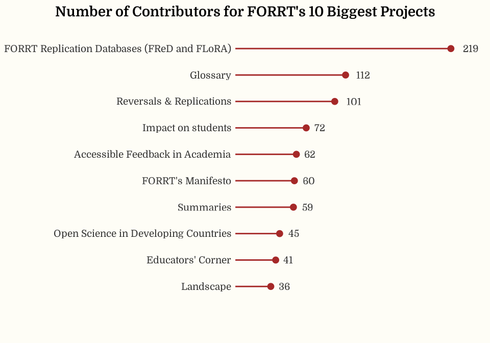
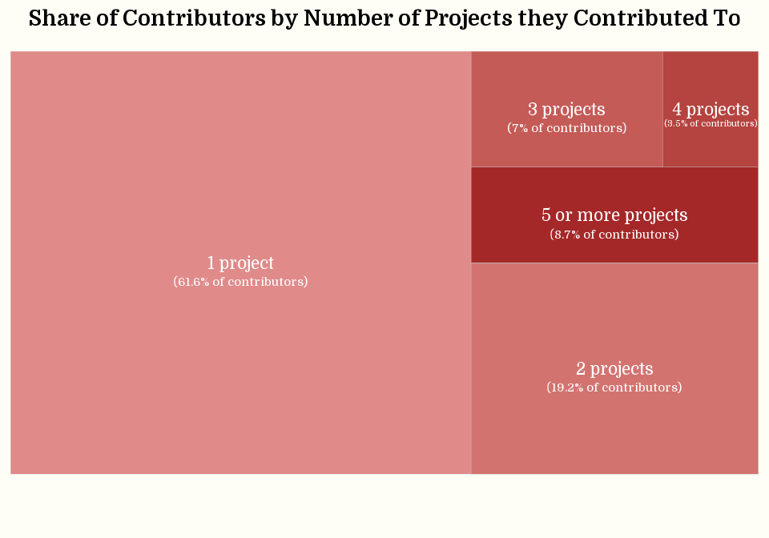
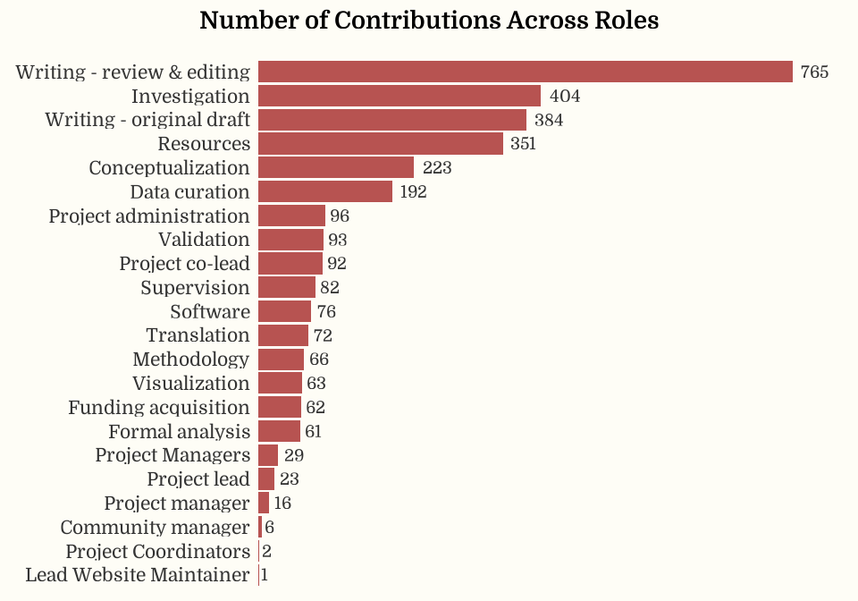

As of 09 November 2026, FORRT has a total of 109 completed or ongoing
projects and support teams, with a total of 656 contributors. There is
an average (mean) of 2.44 contributions per person across all FORRT
projects, and the average number of contributors per project is 14. You
can see the full list of FORRT contributors and their individual
contributions [here](https://forrt.org/contributors/).

<!-- contributor-analysis-data {"as_of":"2026-11-09","projects":109,"contributors":656,"mean_contributions":2.44,"mean_contributors":14,"per_project":[{"name":"FORRT Replication Databases (FReD and FLoRA)","n":220},{"name":"Glossary","n":112},{"name":"Reversals & Replications","n":101},{"name":"Impact on students","n":72},{"name":"Accessible Feedback in Academia","n":62},{"name":"FORRT's Manifesto","n":60},{"name":"Summaries","n":59},{"name":"Open Science in Developing Countries","n":45},{"name":"Educators' Corner","n":41},{"name":"Landscape","n":36},{"name":"Paper: \"Positive Changes from the Replication Crisis\"","n":32},{"name":"Academic Wheel of Privilege","n":26},{"name":"FORRT's Clusters","n":24},{"name":"Neurodiversity Annotated Reading List","n":22},{"name":"Glossary - Arabic Translation","n":21},{"name":"FORRT Lesson Plans","n":19},{"name":"Guide to Carrying out Replication Studies","n":19},{"name":"Replication Research Journal - Advisory Board","n":19},{"name":"Adopting Principled Education","n":18},{"name":"Replication Research Journal - External Member","n":17},{"name":"CERES Manuscript","n":16},{"name":"Replication Research Journal - Editorial Team","n":16},{"name":"Team Website","n":16},{"name":"Team Summaries","n":16},{"name":"Autism & Open Science","n":14},{"name":"Getting Started with FORRT","n":14},{"name":"Participatory Research Primer (BPS)","n":14},{"name":"Team Credit","n":14},{"name":"Team Outreach","n":14},{"name":"FLoRA - Notify preprint alerts","n":13},{"name":"FLoRA Zotero plugin","n":13},{"name":"FORRT's Curated Resources","n":12},{"name":"Glossary - Chinese Translation","n":12},{"name":"German teaching network grant","n":11},{"name":"Open Educational Resources Chapter","n":11},{"name":"Team Curations","n":11},{"name":"BMC Pedagogical Communities","n":10},{"name":"APS Observer","n":8},{"name":"FORRT Self Assessment","n":8},{"name":"OSCARS Grant Application","n":8},{"name":"Pedagogies","n":8},{"name":"FLoRA Extractor","n":8},{"name":"Team Neurodiversity","n":8},{"name":"FORRT Booklet","n":7},{"name":"FORRT Germany Verein","n":7},{"name":"Glossary - Serbian Translation","n":7},{"name":"JUST-OS","n":7},{"name":"Team Cohesion","n":7},{"name":"Team Einstein 2025","n":7},{"name":"FORRT Open Research Extension (Chromium)","n":7},{"name":"FORRT","n":7},{"name":"Glossary - Bulgarian Translation","n":6},{"name":"Mapping Open Science Communities","n":6},{"name":"NWO POST-EDU Grant","n":6},{"name":"Team Ideas","n":6},{"name":"International Coordination Action Research Foundation - Flanders grant","n":6},{"name":"Pubpeer RepNote","n":6},{"name":"FORRT Lighthouse","n":6},{"name":"ReproCrowd","n":6},{"name":"Promoting Open Science Teaching: A Positive, Inclusive and Participatory Program for\r\nEducators (POST-Edu)","n":6},{"name":"Team Mapping Open Science Organizations","n":6},{"name":"Glossary - German Translation","n":5},{"name":"Glossary - Portuguese Translation","n":5},{"name":"International Initiatives to Enhance Awareness and Uptake of Open Research in Psychology","n":5},{"name":"IOI Grant","n":5},{"name":"Neurodivergent Authors Database","n":5},{"name":"NWO TRACKREP Grant","n":5},{"name":"Team Einstein 2022","n":5},{"name":"Team Einstein 2023","n":5},{"name":"Equity in Open Scholarship","n":4},{"name":"FReD R package","n":4},{"name":"Glossary - Italian Translation","n":4},{"name":"Open Research Book","n":4},{"name":"FReD (FORRT Replication Database)","n":4},{"name":"Team Feedback","n":4},{"name":"Team Glossary | Phase 1","n":4},{"name":"Team Replication Crisis Paper","n":4},{"name":"FORRT Robustness Lighthouse","n":3},{"name":"Team Citation Politics","n":3},{"name":"Team Database","n":3},{"name":"Team Ethics","n":3},{"name":"Team Open Science in Developing Countries","n":3},{"name":"Team Replication Hub","n":3},{"name":"Glossary - Bengali Translation","n":2},{"name":"Glossary - Spanish Translation","n":2},{"name":"UNESCO/UN Application","n":2},{"name":"Team Clusters","n":2},{"name":"Team Glossary | Phase 2 | Expansion","n":2},{"name":"Team Impact on Students","n":2},{"name":"Team JUST-OS","n":2},{"name":"Team Lesson Plans  | Phase 1","n":2},{"name":"Team Manuscript/Manifesto","n":2},{"name":"Team Reversals and Replication","n":2},{"name":"Team Wheel of Privilege","n":2},{"name":"Team Youth","n":2},{"name":"FORRTifying Open Science in The Netherlands: Grant","n":1},{"name":"Parliament inquiry","n":1},{"name":"Team Ambassador","n":1},{"name":"Team BMC research note","n":1},{"name":"Team Glossary | Phase 2 | Translation","n":1},{"name":"Team Landscape","n":1},{"name":"Team Lesson Plans  | Phase 2","n":1},{"name":"Team Pedagogies","n":1},{"name":"Tracking and Mainstreaming Replications across the Social, Behavioral and Cognitive Sciences","n":1},{"name":"Team Games for Open Science","n":1},{"name":"Team Opportunities","n":1},{"name":"German Teaching Network Grant","n":1},{"name":"Nowhere Lab","n":1},{"name":"Leo Waaijers OS Award","n":1}],"projects_per_person":[{"label":"1 project","n":404,"percent":61.6},{"label":"2 projects","n":126,"percent":19.2},{"label":"3 projects","n":46,"percent":7},{"label":"4 projects","n":23,"percent":3.5},{"label":"5 or more projects","n":57,"percent":8.7}],"roles":[{"name":"Writing - review & editing","n":765},{"name":"Investigation","n":404},{"name":"Writing - original draft","n":384},{"name":"Resources","n":353},{"name":"Conceptualization","n":229},{"name":"Data curation","n":193},{"name":"Project administration","n":99},{"name":"Validation","n":94},{"name":"Project co-lead","n":92},{"name":"Supervision","n":84},{"name":"Software","n":82},{"name":"Translation","n":72},{"name":"Methodology","n":68},{"name":"Visualization","n":66},{"name":"Funding acquisition","n":62},{"name":"Formal analysis","n":61},{"name":"Project Managers","n":45},{"name":"Project lead","n":23},{"name":"Community manager","n":6},{"name":"Project Coordinators","n":2},{"name":"Lead Website Maintainer","n":1}]} -->
