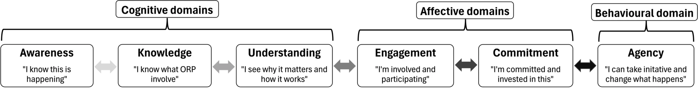
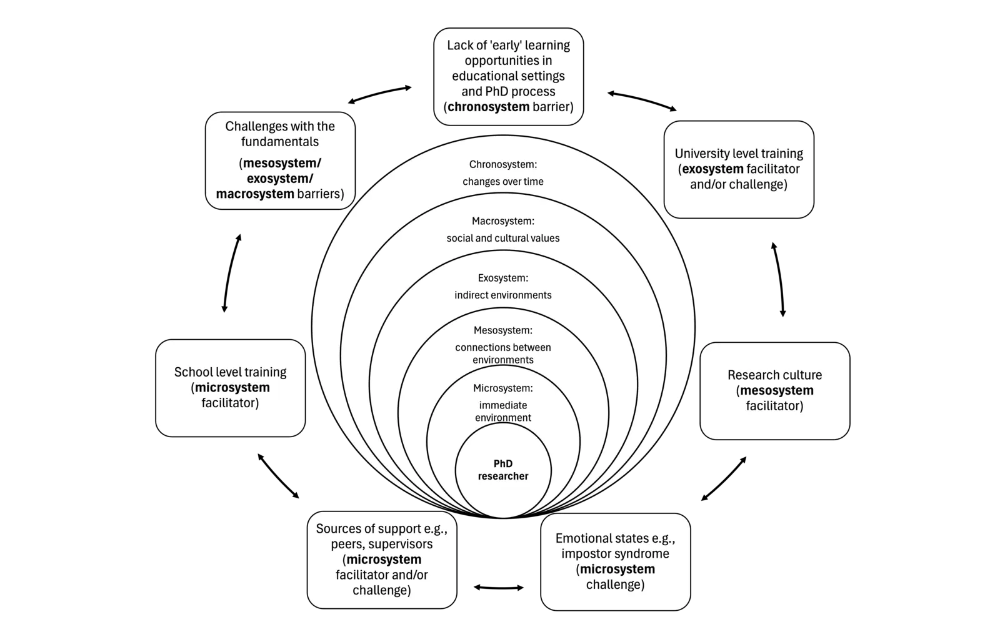
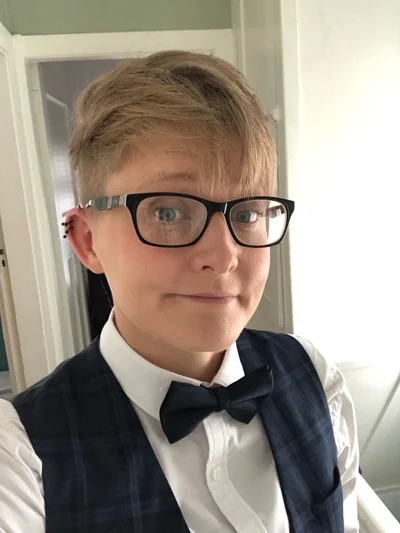

As Open Research Practices (ORP) become increasingly embedded within research culture, postgraduate researchers are often expected to engage with ORP such as pre-registration, data sharing, and open materials. However, guidance documents alone rarely lead to meaningful engagement unless supported by active learning strategies or social reinforcement (Adam-Ismail, 2023; Munna & Kalam, 2021). To address this challenge, we designed, delivered, and evaluated a 90-minute ORP workshop for postgraduate researchers that combined three active learning strategies: Reflective Group Discussions (RGD), Expert Narratives (EN), and Live Demonstrations (LD). Drawing on cognitive-affective-behavioural learning models (e.g., Bloom et al., 1956; Krathwohl et al., 1964; OECD, 2026), three active learning strategies were intentionally selected and sequenced within the workshop (RGD-EN-LD). The intentional design sought to move beyond knowledge transfer by supporting researchers to reflect on their motivations, connect with authentic examples of ORP in practice, and develop confidence using the Open Science Framework (OSF).

To evaluate the effectiveness of the workshop with three active learning strategies, a mixed methods design was adopted. Fifteen postgraduate researchers attended the workshop. Anonymous questionnaires (N = 4; first-year = 1; third year = 3) were analysed descriptively to capture breadth, while interviews with postgraduate researchers (N = 4; first-year = 2; third year = 2) and co-facilitator (N = 1) were analysed using Braun and Clarke's (2006; 2019) six-step thematic analysis framework and offered in-depth insight into context and individual experiences.

## Pedagogical practice: Learning framework from cognitive awareness to action-oriented ownership

Findings suggested that the workshop facilitated a progression from cognitive awareness to action-oriented ownership. The intentionally sequenced active learning strategies (RGD-EN-LD) supported this progression by enabling meaningful understanding and engagement with ORP. The following learning framework was developed.

Participants described how reflective discussions encouraged them to consider their role within the research ecosystem (Bronfenbrenner, 1976; Bronfenbrenner & Morris, 2007), while expert narratives provided authentic examples of how researchers enact ORP in different ways. Live demonstrations then translated these ideas into practical action through guided engagement with OSF pre-registration. Importantly, the findings indicated that knowledge alone was insufficient to promote engagement. Awareness, belonging, agency and opportunities for practice emerged as equally important factors influencing researchers' willingness to adopt ORP. The three active learning strategies appeared to work synergistically, with reflection fostering motivation, narratives strengthening professional identity and community connection, and live demonstrations reducing uncertainty around implementation.

## Contextual conditions: Research ecosystem shapes engagement with open research practices

The project also highlighted the importance of the wider research ecosystem (Bronfenbrenner, 1976; Bronfenbrenner & Morris, 2007). Participants identified supervisors, peers, institutional support, and early exposure to ORP as key influences on engagement.

As a result, several changes were implemented, including the expansion of ORP postgraduate training through researcher development provision, adaptations to activities for online delivery, and efforts to embed ORP earlier within the educational journey. Ultimately, this project reinforced a simple but important lesson for educators: effective ORP education is not only about helping learners understand open research, but about creating opportunities to reflect, connect, practise, and develop the confidence to act as contributors to an open and responsible research culture. For future ORP pedagogy to be effective it requires institutional support to champion ORP as a routine component of high-quality research.

## Resources

- The lesson plan for this workshop is available on FORRT's [Lesson Plans page](/lesson-plans/#open-research-phd) ([PDF](/lesson-plans/LessonPlan_OpenResearchPhD.pdf), [editable Word version](/lesson-plans/LessonPlan_OpenResearchPhD.docx)).
- The project and workshop slides are on [OSF](https://osf.io/82t9c/overview).

## About the author

  

    
  

  

    <strong>Dr Abbie Cahoon</strong> is a Lecturer in Developmental Psychology at Ulster University and the university's open research champion. 
    Email: <a href="mailto:a.cahoon@ulster.ac.uk">a.cahoon@ulster.ac.uk</a> 
    Staff profile: <a href="https://www.ulster.ac.uk/staff/a-cahoon">ulster.ac.uk/staff/a-cahoon</a> 
    OSF: <a href="https://osf.io/qpxrw/">osf.io/qpxrw</a>
  

