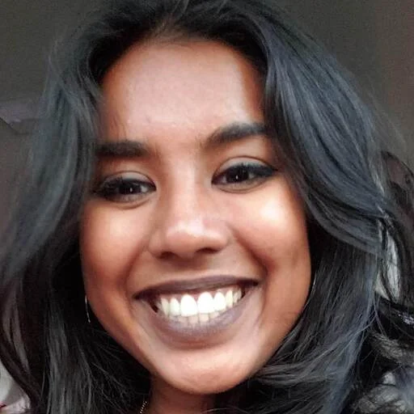
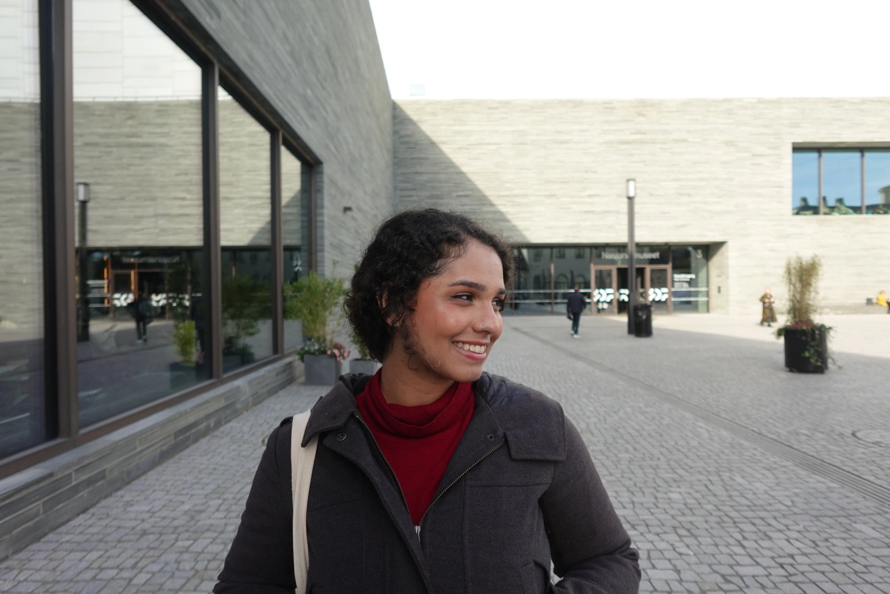

+++
widget = "blank"
headless = true
active = true
weight = 5

title = "Community stories & testimonials"
subtitle = ""

[design]
  columns = "1"

[design.background]
  text_color_light = false

[design.spacing]
  padding = ["60px", "0", "60px", "0"]

[advanced]
  css_style = ""
  css_class = ""
+++

  
FORRT is an inclusive community in Open Research built on care, equity, and collaboration—shaping the future of inclusive open scholarship, one story at a time. FORRT's mission is explicit about empowering early-career scholars, educators, and changemakers around the world. Our members have found mentorship, purpose, and belonging while contributing to a more inclusive and just vision of open scholarship. These stories remind us that behind every organization, infrastructure, educational material, or publication are people—people learning, growing, and reshaping the future of science, together. On this page, we share their journeys and first-hand reflections on growth, belonging, and transformation through FORRT.

  <aside class="stories-head-note" aria-label="Share your story">
    
Have a FORRT story?

    
We love hearing how FORRT has supported your personal and professional growth. Email <a href="mailto:info@forrt.org">info@forrt.org</a> to share yours, or <a href="/about/get-involved/">join the community</a>.

  </aside>

<nav class="stories-jump" aria-label="Jump to a community story">
  <a href="#roksana-sobolak">Roksana Sobolak</a>
  <a href="#max-korbmacher">Max Korbmacher</a>
  <a href="#leonie-dudda">Leonie A. Dudda</a>
  <a href="#richard-dushime">Richard Dushime</a>
  <a href="#andrea-kis">Dr. Andrea Kis</a>
  <a href="#adira-daniel">Adira Daniel</a>
  <a href="#ana-carolina-marinho">Ana Carolina Marinho</a>
</nav>
