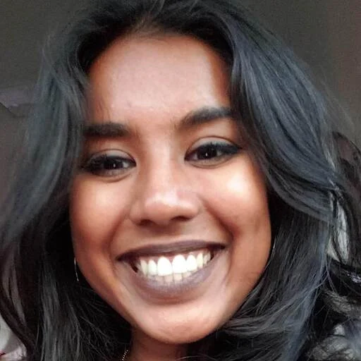

+++
widget = "blank"
headless = true
active = true
weight = 16

title = ""
subtitle = ""

[design]
  columns = "1"

[design.background]
  text_color_light = false

[design.spacing]
  padding = ["20px", "0", "20px", "0"]

[advanced]
  css_style = ""
  css_class = ""
+++

<article class="story-card story-card-calm" id="adira-daniel" aria-labelledby="story-adira-h">
  

    

      
    

    

      
Adira Daniel

      
Ph.D. Candidate &amp; FORRT Steward

      

        <a href="mailto:adanie48@uwo.ca" aria-label="Email Adira Daniel" title="Email"><i class="fas fa-envelope" aria-hidden="true"></i></a>
        <a href="https://orcid.org/0009-0004-6830-2141" target="_blank" rel="noopener" aria-label="Adira Daniel on ORCID" title="ORCID"><i class="ai ai-orcid" aria-hidden="true"></i></a>
        <a href="https://www.linkedin.com/in/adiradaniel/" target="_blank" rel="noopener" aria-label="Adira Daniel on LinkedIn" title="LinkedIn"><i class="fa-brands fa-linkedin" aria-hidden="true"></i></a>
      

    

  

  

    <h2 id="story-adira-h">Doing good research, together: Growing with FORRT</h2>
    
I joined FORRT at the very beginning of my PhD, during a period shaped by COVID-19 lockdowns, when I was deeply motivated to do research well but still learning what that could look like in practice. I was searching for ways to meaningfully engage with metascience and to move beyond abstract commitments to open science toward concrete, values-driven research practices.

    
Participating in FORRT gave me exactly that. Through hands-on collaboration, mentorship, and shared reflection, I learned how to actively engage with open and reproducible research principles as an integrated part of my doctoral training. What began as volunteer involvement quickly became a formative space for growth — intellectually, professionally, and personally — grounded in learning with others.

    
Now, as a FORRT Steward, I am especially grateful for the community that has supported me at every stage of my journey. FORRT continues to shape how I think about rigor, care, and responsibility in research, and it remains a community I am excited to keep building with — not just throughout my PhD, but well beyond it.

  

</article>
