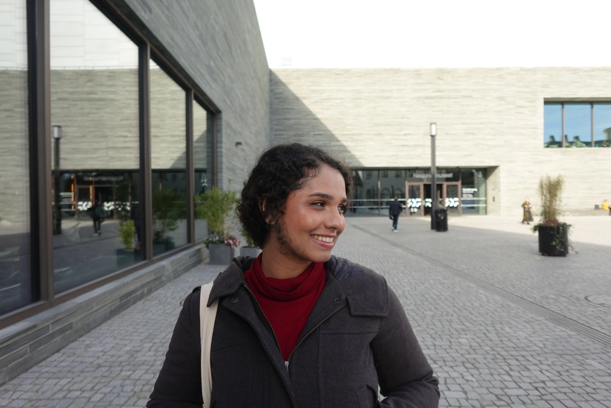

+++
widget = "blank"
headless = true
active = true
weight = 17

title = ""
subtitle = ""

[design]
  columns = "1"

[design.background]
  text_color_light = false

[design.spacing]
  padding = ["20px", "0", "20px", "0"]

[advanced]
  css_style = ""
  css_class = ""
+++

<article class="story-card story-card-warm" id="ana-carolina-marinho" aria-labelledby="story-ana-h">
  

    

      
    

    

      
Ana Carolina Marinho

      

        <a href="mailto:carolsmarinho.ana@gmail.com" aria-label="Email Ana Carolina Marinho" title="Email"><i class="fas fa-envelope" aria-hidden="true"></i></a>
        <a href="https://orcid.org/0000-0002-8456-4545" target="_blank" rel="noopener" aria-label="Ana Carolina Marinho on ORCID" title="ORCID"><i class="ai ai-orcid" aria-hidden="true"></i></a>
        <a href="https://www.linkedin.com/in/anacarolinasoaresmarinho/" target="_blank" rel="noopener" aria-label="Ana Carolina Marinho on LinkedIn" title="LinkedIn"><i class="fa-brands fa-linkedin" aria-hidden="true"></i></a>
      

    

  

  

    <h2 id="story-ana-h">From Brazil to the world: How a seemingly 'small' opportunity changed the course of my career</h2>
    
Coming from an academic environment that can be highly competitive, it’s hard to even imagine what it feels like to be part of a culture rooted in collaboration — but FORRT has been that breath of fresh air for me.

    
Doing research can be incredibly demotivating and lonely. At FORRT, however, I found a diverse community of people who understood what I was feeling — and even when they didn’t fully understand, they listened. That changed everything for me.

    
Feeling heard, welcomed, and valued made me realize how much others need that too.

    
Every day I learn something new, whether on the technical side or the human side of research. And although I clearly see how FORRT contributes to my professional growth, I also genuinely feel that my own contributions to the community matter just as much. I feel like I belong.

    
I can’t wait to see what’s still to come. Thank you, FORRT!

  

</article>
